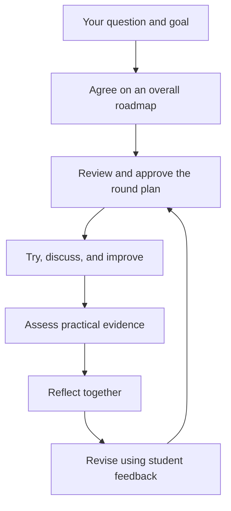

# StudySkill

### Let learning begin with a question of your own.

**A reusable Agent Skill for interactive teaching, guided by your goals, practical work, and feedback.**

**English** | [简体中文](README.zh-CN.md)

You choose what to learn. An AI tutor helps you plan, work through meaningful problems, and demonstrate understanding. Your experience shapes the next round of teaching, with a record you can return to.

> **You choose the direction. Practice reveals understanding. Your feedback changes the teaching.**

[Quick start](#quick-start) · [How it works](#how-it-works) · [The philosophy](#the-philosophy) · [Examples](#examples) · [Inside the repository](#inside-the-repository)

## Quick start

StudySkill is a set of teaching instructions for an AI assistant that can read skill files. Use this repository as a separate learning workspace.

### 1. Get the workspace

Download the repository, or clone it:

```bash
git clone https://github.com/klsdxf/Studyskill.git
cd Studyskill
```

### 2. Load the skill

Open the workspace in your assistant. Environments with compatible Agent Skills discovery can find `.agents/skills/studyskill/`. Where explicit invocation is supported, start with:

```text
$studyskill

I want to understand databases by adding history to my app.
I know basic programming, but I'm new to SQL.
Help me clarify the goal, then propose an overall roadmap
and a complete plan for the first learning round.
```

If your assistant does not discover the skill, ask it to read [`.agents/skills/studyskill/SKILL.md`](.agents/skills/studyskill/SKILL.md) and follow it for your learning request.

### 3. Agree on the plan, then begin

Review the overall roadmap and the first round's plan. The tutor starts teaching after you approve the relevant plan. You do not need a finished project idea: a subject, a book, or a question is enough to begin the conversation.

Learning records are created under `learning/` only when a course actually starts.

## What changes in your learning

| What matters | What StudySkill asks the tutor to do |
|---|---|
| **Your direction** | Clarify your goal and scope with you. Let curiosity, understanding, or a practical need set the destination. |
| **A visible plan** | Show the overall roadmap, then a complete plan for each round before teaching it. |
| **Meaningful interaction** | Use your attempts to decide what to explain. Give direct explanations when foundations are missing. |
| **Evidence of understanding** | Check what you can do, explain, and adapt. Record independent work and assisted work separately. |
| **A voice in the teaching** | Include your experience in reflection and show how it changes the next plan. |
| **Continuity** | Record meaningful steps, evidence, feedback, and the point where you stopped. |

## How it works



A learning round can contain several sections. Its plan explains the problem, purpose, student task, and assessment evidence for each section. If a gap remains, address that specific gap; demonstrated understanding does not need repeated practice.

During teaching, the tutor can move between questions, hints, explanation, and demonstration. Each task should produce something meaningful: a working feature, an argument, an experiment, a piece of writing, or a reasoned decision. The amount of help is recorded.

At the end of a round, both sides reflect. Feedback also matters during the round: pacing, examples, and task size can change immediately. Substantial changes to goals, route, or required assessment come back to you for approval.

## The philosophy

### Give learners a say in their education

I want to challenge a familiar pattern in traditional education: students follow a predetermined sequence, with little influence over the questions, pace, or teaching itself.

Learners should be able to say, “Why am I learning this?”, “I already know this,” or “That explanation didn't help”—and have those words change the course.

**StudySkill puts that ambition into the teaching process: students help decide the goal, practice reveals what they understand, and feedback changes what comes next.** There is no required career destination, fixed number of rounds, or obligation to turn every subject into a software project.

### Follow the problems that gave methods a purpose

Many ideas make more sense when we see the problems they helped solve. A method works, meets a limitation, and prompts a new approach. Teaching follows those turning points so that concepts arrive with a reason to learn them.

For data storage, a teaching scenario might follow:

```text
Save records in a file
  → finding and updating records becomes awkward
  → explore better organization and queries
  → handle relationships between records
```

This is a simplified teaching scenario. Real history branches, overlaps, and revises itself; the tutor must distinguish verified history from instructional simplification.

Try an earlier method when it exposes an important problem. Summarize it when it provides context. Skip it when it adds little to the goal. Age alone does not determine whether a method is still useful.

### Assess the learner and improve the teaching

Assessment asks whether you can complete a task, explain important choices, and adapt to a changed condition. Programming can involve a feature; mathematics, a derivation and a variation; writing, a text and its revisions.

Independent work, prompted work, following a demonstration, and AI-completed work are recorded separately. Reading a chapter or watching the tutor finish a task does not establish practical competence.

Reflection then examines the teaching as well:

| Student feedback | A concrete response |
|---|---|
| “The tasks are too fragmented.” | Show the complete goal and group related steps into a useful result. |
| “The example works, but I can't explain why.” | Use explanation, prediction, and a variation to locate the gap. |
| “I want to focus on principles first.” | Propose a revised route built around reasoning and small experiments, for the student to approve. |

**The next plan must explain what you said and what changed because of it.**

## Examples

Adapt these starting points to your interests:

| Starting point | A request you could bring |
|---|---|
| A subject | “I want to understand probability. Start with the problems it helps us solve.” |
| A question | “How do computers represent language, and why have those methods changed?” |
| A book | “Help me work through this mathematics book. Use my attempts to decide where I need help.” |
| A practical need | “I want to add history to my app and understand the storage choices.” |

You can also steer an active course:

```text
The tasks feel too fragmented. Before we continue, show me how they
fit together and propose a more coherent task.
```

```text
Let's review this round. Include what I demonstrated, where I needed
help, my experience, and what should change in the next plan.
```

These are example requests, not reports of teaching outcomes.

## How to tell it is working

Look for observable behavior:

- You see why a task matters before attempting it.
- The tutor responds to your actual work and avoids repeating demonstrated skills.
- Assessment identifies the evidence and how much help you received.
- Your feedback produces a visible change in teaching or the next plan.
- Returning to a course restores its goal, current question, and unfinished work.

These are checks on whether the workflow is being followed. Learning outcomes still need evaluation through real use.

## Inside the repository

| File | Purpose |
|---|---|
| [SKILL.md](.agents/skills/studyskill/SKILL.md) | Skill entry point and core workflow |
| [planning-and-teaching.md](.agents/skills/studyskill/references/planning-and-teaching.md) | Roadmaps, round plans, and teaching through problems and methods |
| [reflection.md](.agents/skills/studyskill/references/reflection.md) | Student experience, tutor reflection, and follow-through |
| [records.md](.agents/skills/studyskill/references/records.md) | Progress, events, evidence, and resuming a course |
| [AGENTS.md](AGENTS.md) | Workspace instructions and boundaries |

Once a course begins, its separate records can include:

```text
learning/<topic-id>/
├── state.json        # Current progress and resume point
├── events.jsonl      # Learning steps, evidence, and feedback
├── plans/            # Overall and round plans, with versions
├── reviews/          # Reflections from both sides
├── practice/         # Student work and labeled demonstrations
└── reports/          # Derived views, when needed
```

Directories are created as needed. Teaching rules stay in the skill; personal progress stays in the course workspace. 

## Status and contributions

The current release consists of teaching specifications. It does not include a standalone teaching app or independently validated learning outcomes. Actual teaching depends on the assistant, the materials, and the participation of learner and tutor.

Help improve it through [concrete learning experiences](https://github.com/klsdxf/Studyskill/issues): what you wanted to learn, what happened, what helped or caused friction, and how the teaching should change. Remove personal information before sharing examples.

**Start with the question you truly want to understand.**
