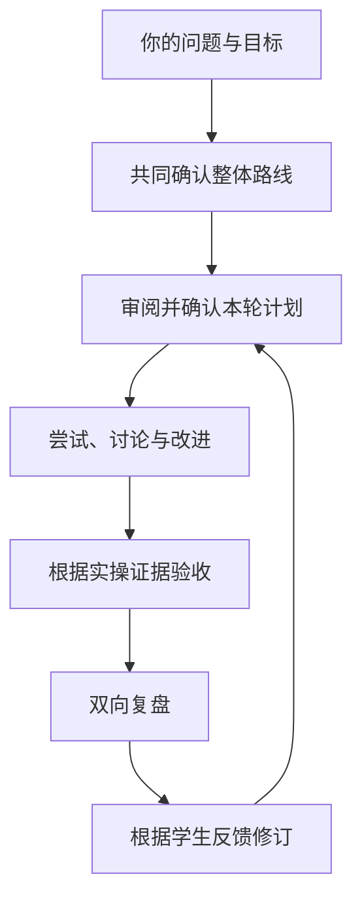

# StudySkill

### 让学习，重新从一个属于你的问题开始。

**一套可复用的交互教学 Agent Skill，让你的目标、实操与反馈共同塑造学习。**

[English](README.md) | **简体中文**

你决定学什么，AI 教师与你一起规划路线、解决具体问题、检验理解。你的学习体验参与决定下一轮如何开展，过程记录让每次回来都能继续。

> **方向由你选择，理解由实践检验，教学因你的反馈而改变。**

[快速开始](#快速开始) · [教学如何推进](#教学如何推进) · [设计理念](#设计理念) · [使用示例](#使用示例) · [仓库结构](#仓库结构)

## 快速开始

StudySkill 是供能够读取技能文件的 AI 助手执行的教学规范。将本仓库作为独立的学习工作区使用。

### 1. 获取工作区

下载仓库，或克隆到本地：

```bash
git clone https://github.com/klsdxf/Studyskill.git
cd Studyskill
```

### 2. 加载 skill

在助手中打开工作区。兼容 Agent Skills 发现机制的环境可以找到 `.agents/skills/studyskill/`。支持显式调用时，可以这样开始：

```text
$studyskill

我想通过给自己的应用增加历史记录来理解数据库。
我有基础编程经验，但没学过 SQL。
先和我明确目标，再给出整体路线和第一轮的完整计划。
```

如果助手没有自动发现 skill，请让它读取 [`.agents/skills/studyskill/SKILL.md`](.agents/skills/studyskill/SKILL.md)，并按照其中规范处理你的学习请求。

核心教学规范目前使用中文，英文 README 提供项目介绍。实际加载和调用方式取决于所用助手的能力。

### 3. 确认计划，开始学习

先审阅整体路线和第一轮计划，确认相应计划后再开始教学。不需要先想好完整项目：一个学科、一本书或一个疑问，都可以成为对话的起点。

只有实际开始课程后，才会在 `learning/` 下创建学习记录。

## 学习中会发生哪些改变

| 你关心的事 | StudySkill 要求教师如何回应 |
|---|---|
| **自己决定方向** | 共同澄清目标与范围，让好奇、理解或实际需求决定终点。 |
| **提前看见计划** | 先展示整体路线，每轮开始前再展示完整小节计划。 |
| **有意义的交互** | 根据你的尝试决定讲什么；缺少必要基础时直接解释。 |
| **学会有据可查** | 检查你能否完成、解释和迁移，分别记录独立完成与协助完成。 |
| **体验能改变教学** | 将学生体验纳入复盘，并说明下一轮因此作出的调整。 |
| **下次接着学** | 记录有意义的步骤、证据、反馈和当前断点。 |

## 教学如何推进



一轮学习可以包含多个小节，计划提前交代各节的问题、目的、本人任务和验收证据。未通过时只补具体缺口，已证明掌握的内容无需重复练习。

教学中，教师根据需要在提问、提示、讲解与示范之间切换。每个任务尽量形成有意义的小成果：一个可用功能、完整推导、小实验、短文或有依据的判断。帮助程度也会记录。

轮末由双方共同复盘。反馈也可以在途中发生：节奏、例子和任务大小及时调整；目标、路线或必需验收的实质变化，则交由你确认。

## 设计理念

### 把学习的决定权交还给学生

我想尝试颠覆传统教育中一种熟悉的学习方式：学生沿着预设进度接收知识，却很少有机会决定问题、节奏，或者改变教学本身。

学习者应该能够说：“我为什么要学这个？”“这一步我已经会了。”“刚才的讲法没有帮助我理解。”而这些话，能够真正改变课程。

**StudySkill 将这个愿望落实为教学过程：学生参与决定目标，实操呈现理解，反馈改变后续安排。** 不预设就业终点，不固定轮数，也不要求所有学科都变成软件项目。

### 沿着问题与方法的演进学习

许多知识背后，都有一个值得解决的问题。一种方法发挥作用，又在新的条件下暴露局限，推动后续方法产生。教学沿这些关键转折展开，让概念带着它要解决的问题登场。

例如，数据存储可以从这样的教学情境进入：

```text
用文件保存记录
  → 查找和修改逐渐麻烦
  → 探索更合适的数据组织与查询
  → 进一步处理记录之间的关联
```

这是教学简化。真实历史存在分支、并行探索和反复，教师必须区分经过核实的历史与为理解而设计的情境。

能揭示关键问题的旧方法，值得体验；只有背景价值的，简要介绍；对目标帮助小的，直接跳过。方法是否仍适用，要看具体场景，不能只凭年代判定。

### 检验学生理解，也改进教师的教学

验收关注能否完成任务、解释关键选择，以及条件变化后能否调整方法。编程可以实现功能，数学可以推导和解变式题，写作可以完成文本并解释修改取舍。

独立完成、有提示完成、跟随示范和 AI 代做分别记录。读完章节或看教师做完，不能直接证明本人具备实操能力。

复盘还要检查教学本身：

| 学生反馈 | 具体调整 |
|---|---|
| “任务太碎了。” | 先展示完整目标，把相关步骤合成有用的小成果。 |
| “例子跑通了，但我解释不清。” | 用解释、预测与变式练习定位理解缺口。 |
| “我想先理解原理。” | 提出以推导和小实验为主的新路线，由学生确认。 |

**下一轮计划需要说明：你反馈了什么，教学因此改变了什么。**

## 使用示例

按自己的兴趣改写这些起点：

| 起点 | 你可以提出的请求 |
|---|---|
| 一个学科 | “我想理解概率，从它能解决什么问题开始。” |
| 一个疑问 | “计算机如何表示语言，这些方法为什么不断变化？” |
| 一本书 | “陪我学习这本数学书，根据我的尝试判断哪里需要帮助。” |
| 一个实际需求 | “我想给应用加历史记录，并理解背后的存储选择。” |

学习过程中，你也可以主动调整教学：

```text
任务太碎了。继续之前，先说明它们之间的联系，
再提出一个更完整、可完成的小任务。
```

```text
复盘这一轮：包括我实际证明了什么、哪里有帮助、
我的学习体验，以及下一轮应该怎样调整。
```

以上为请求示例，不代表已经取得的教学效果。

## 如何判断它正在起作用

观察具体行为：

- 动手前，你知道这个任务为什么值得做。
- 教师回应你的实际作品，避免重复已掌握的内容。
- 验收说明证据和帮助程度。
- 你的反馈在教学方式或下一轮计划中产生可见变化。
- 恢复课程时，可以找到目标、当前问题和未完成事项。

这些可以检查流程是否得到执行；学习成效仍需要在真实使用中评估。

## 仓库结构

| 文件 | 作用 |
|---|---|
| [SKILL.md](.agents/skills/studyskill/SKILL.md) | skill 入口与核心教学流程 |
| [planning-and-teaching.md](.agents/skills/studyskill/references/planning-and-teaching.md) | 两层计划与问题演进式教学 |
| [reflection.md](.agents/skills/studyskill/references/reflection.md) | 学生体验、教师复盘和调整落实 |
| [records.md](.agents/skills/studyskill/references/records.md) | 进度、事件、证据与断点恢复 |
| [AGENTS.md](AGENTS.md) | 工作区规范与边界 |

实际开课后，独立的课程记录可以包含：

```text
learning/<topic-id>/
├── state.json        # 当前进度和恢复位置
├── events.jsonl      # 学习步骤、证据与反馈
├── plans/            # 有版本的整体与逐轮计划
├── reviews/          # 双向复盘
├── practice/         # 学生作品与标明来源的示范
└── reports/          # 按需生成的派生展示
```

目录按需创建。通用教学方法保留在 skill，个人进度保存在课程工作区。

**从你真正想弄懂的那个问题开始。**
